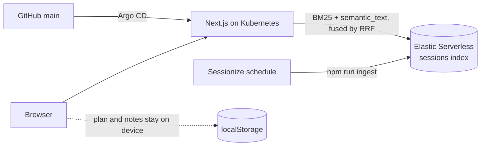

# FocusTrack

A focus-friendly conference companion: find the right talk, plan a day you can actually absorb, and stay present in the room.

- Live: https://focustrack.cnh.radarhq.io
- Demo: https://focustrack.cnh.radarhq.io/?now=2026-11-10T11:15-07:00

The real talks happen November 10-12, 2026 (KubeCon + CloudNativeCon North America, Salt Lake City). The `?now=` parameter pins a visible "Demo time" banner so the demo reads as Tuesday 11:15 MT. Remove the parameter to return to the live clock.

Built for the WeMakeDevs Cloud Native Hackathon.

## The problem

A big conference packs hundreds of sessions into a few days. For autistic, anxious, ADHD, and Deaf or hard-of-hearing attendees, that volume is more than a scheduling nuisance: back-to-back sessions, crowded rooms, long walks between buildings, and noisy halls drain energy fast, and a missed accommodation can mean missing the talk entirely. Most schedule tools help you add more sessions. FocusTrack helps you pick fewer, take them in well, and leave the room when you need to.

## What it does

| Area | Status | What you get |
| --- | --- | --- |
| Find | Live on main | Hybrid search (keyword plus semantic) over the real KubeCon NA 2026 schedule. Filter by day and hide restricted sessions (sold out, separate registration, all-access pass). Results show event-time schedule, room, speakers, and type. |
| Plan | On main ([PR #13](https://github.com/nelsons502/focustrack/pull/13)). | Save session IDs locally, review overlaps and load against adjustable thresholds, and choose a real quiet-room break. |
| Be present | On main ([PR #7](https://github.com/nelsons502/focustrack/pull/7)) | A calm Now screen with the current and next session, device-local notes, and a reversible not-attending action. |
| Plain-language summaries | Prepared data on main ([PR #6](https://github.com/nelsons502/focustrack/pull/6)); display integration pending. | Ten reviewed previews, ready to apply to Elastic and display with an explicit AI label after approval. |

Honest accessibility data runs through all of it. Crowd and noise appear only as labelled estimates with their basis, or as "unknown", and never as "small" or "quiet". Caption and quiet-room information comes from the official accessibility page. If semantic search is unavailable, the API falls back to keyword search and the UI says so.

## Architecture



Key decisions:

- **Elastic is the only schedule store.** The `sessions` index holds the schedule's sessions (routine logistics such as registration and meals are dropped at ingest). Search, filters, and agenda lookups are Elasticsearch queries, not in-memory filtering.
- **RRF instead of score blending.** Keyword (BM25) and `semantic_text` scores are on different scales. Reciprocal rank fusion merges the two ranked lists without tuning weights, and filters are applied inside both sub-queries.
- **Personal data stays on the device.** Plan and settings live in `localStorage` (`focustrack:v1`). Selected public session IDs are sent to the schedule lookup API to retrieve times and rooms; notes, settings and reflection answers are not sent.
- **Estimates never claim "quiet".** Crowd is derived from room type and noise from the exhibit hall; a wrong reassurance harms noise-sensitive attendees, so everything else is "unknown". The rules are in `lib/contract.ts`.
- **GitOps on Radar and Argo CD.** A push to `main` builds an image, updates `deploy/kustomization.yaml`, and Argo CD syncs the cluster. See [`docs/radar.md`](docs/radar.md).
- **AI only ahead of time, apart from search.** Elastic's built-in inference embeds descriptions at ingest and the query at search time; no generative model runs in the app, and summaries are generated beforehand and reviewed.

## Sponsor tools and how we used them

**Elastic.** Elastic Serverless is the core data layer: a `sessions` index with an explicit mapping, a `semantic_text` field using built-in inference, and an RRF retriever that fuses a BM25 `multi_match` with a semantic query. See [`lib/elastic.ts`](lib/elastic.ts) and [`lib/elastic-search.ts`](lib/elastic-search.ts). The `/readyz` probe also checks that Elastic is reachable.

**Gitar (Sonar).** Features land as separate pull requests. Project-aware review rules live in [`.gitar/review/conventions.md`](.gitar/review/conventions.md) (strict TypeScript, event time zones, Elastic as the data layer, RRF) and [`.gitar/review/product-principles.md`](.gitar/review/product-principles.md) (focus-first, accessibility, honest data, privacy). Gitar findings, automatic code corrections, and CI outcomes are visible on the [pull requests](https://github.com/nelsons502/focustrack/pulls?q=is%3Apr).

**Radar.** The app runs on Kubernetes in the team namespace, deployed by Argo CD from [`argocd/application.yaml`](argocd/application.yaml) and [`deploy/`](deploy/), with a GitHub Actions image workflow ([`.github/workflows/image.yml`](.github/workflows/image.yml)). Setup, probes, and the release flow are documented in [`docs/radar.md`](docs/radar.md). A [completed Radar investigation](https://app.radarhq.io/c/uRdEIEL90Yk/investigations/chat_ie6DbFJiQMGlhJN_?org=org_NCJbssDGEBsU) found the deployment healthy at that point in time and identified the missing disruption budget addressed by [PR #15](https://github.com/nelsons502/focustrack/pull/15). Before/after Checks screenshot capture remains pending verification.

**Dash0.** Server traces, correlated logs and metrics around Elastic calls are reviewed in [PR #14](https://github.com/nelsons502/focustrack/pull/14). CLI telemetry has been verified; deployed HTTP telemetry, browser monitoring and a dashboard/SLO still need verification or implementation.

## Accessibility

Sourced facts come from the official [KubeCon + CloudNativeCon NA inclusion and accessibility page](https://events.linuxfoundation.org/kubecon-cloudnativecon-north-america/attend/inclusion-accessibility/): Wordly captions in breakout rooms (follow the instructions posted in each room), and quiet rooms at Salt Palace Level 2, 260A (all attendees) and 260B (women and nonbinary attendees), where conversation and work are discouraged.

Design bar: 44 by 44 pixel touch targets, layouts that reflow at 320 pixels, visible keyboard focus, results announced through an `aria-live` region, `prefers-reduced-motion` respected, and no meaning conveyed by color alone. The target is WCAG 2.2 AA. Manual keyboard and VoiceOver testing is in progress.

## Run it locally

Prerequisites: Node 22 and an Elasticsearch 9 deployment with built-in inference (Elastic Serverless works).

```bash
export ES_URL="https://your-deployment.es.example.com"
export ES_API_KEY="your-encoded-api-key"
npm ci
npm run ingest
npm run dev
npm test
```

- `ES_URL` and `ES_API_KEY` are server-side only and never committed. If the `sessions` index already exists, `npm run ingest -- --recreate` replaces it.
- Ingest fetches the schedule from Sessionize at roughly one request per second, so the first run takes a while.
- CI runs `npm run typecheck`, `npm run lint`, `npm test`, and `npm run build`.

Deploying: Kubernetes through Argo CD (see [`docs/radar.md`](docs/radar.md)), or the Vercel fallback with `vercel deploy --prod`, with `ES_URL` and `ES_API_KEY` set in Vercel's environment settings.

## Data and credit

Schedule data: CNCF / Sessionize ([source](https://sessionize.com/api/v2/uo948i5p/view/markdown)). The repository holds no schedule data beyond short test-fixture excerpts; ingest fetches the schedule at runtime. Plain-language summaries ([PR #6](https://github.com/nelsons502/focustrack/pull/6)) are AI-written and reviewed. Their app display and explicit AI label are a pending integration; the data PR alone does not provide a visible preview.

## AI disclosure

Nelson Schnepf defined the problem, vision, data contract, architecture, and scope, and reviews and merges every pull request.

AI coding agents wrote most of the code under that direction:

- An orchestrator (Claude Code, Claude Opus).
- A build manager (OpenAI Codex, GPT-6.1-Sol).
- Workers and cross-model reviewers (Codex, Muse, and Claude Sonnet and Opus).
- Gitar for pull request review, automatic code corrections and CI analysis. Human review caught and corrected an automatic-close regression in the Now screen; green bot approval alone was not treated as permission to merge.

Every pull request had a reviewer from a different model family than its author.

Runtime AI: Elastic's built-in inference powers semantic search. Plain-language summaries are generated ahead of time and checked. No generative model runs on the live demo path; the only model call at request time is Elastic embedding the search query.

## License

No project license has been selected yet.
